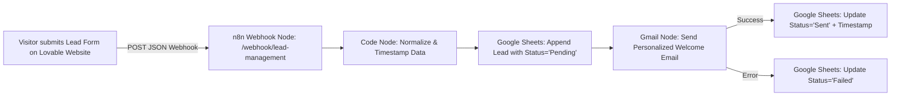
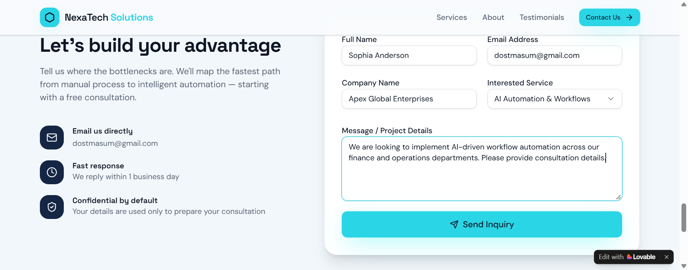
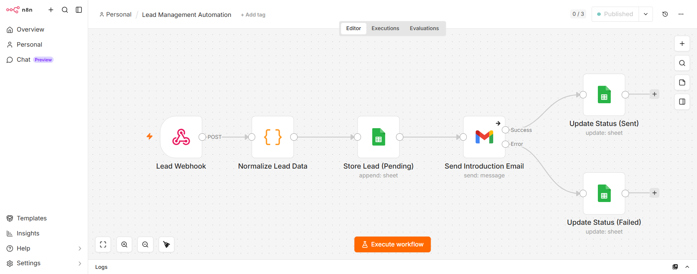
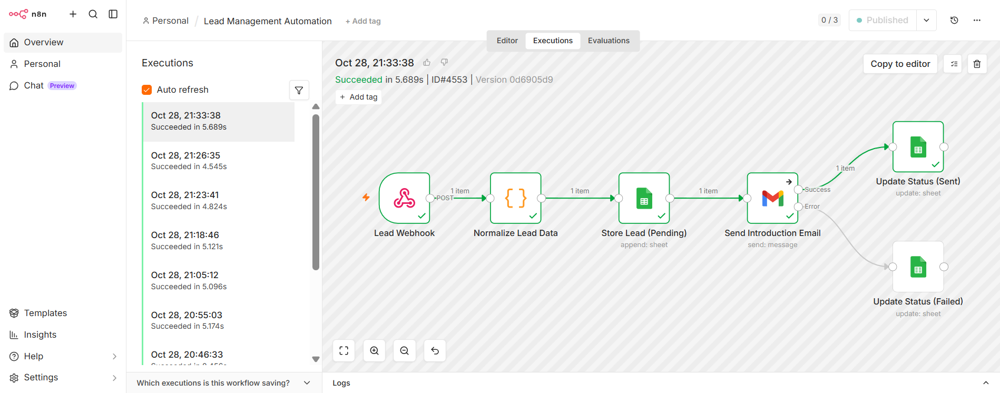
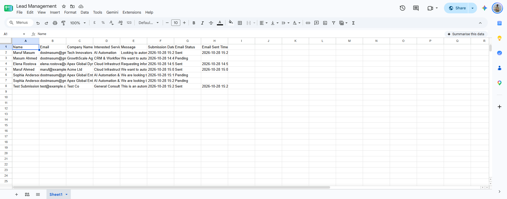

# 🚀 Lead Management & Automated Outreach Engine

[](https://n8n.io/)
[](https://lovable.dev/)
[](https://sheets.google.com/)
[](https://mail.google.com/)
[](https://docker.com/)

An end-to-end automated Lead Management System featuring a modern client-facing corporate website built with **Lovable**, connected to a self-hosted **n8n** automation pipeline running in **Docker**, synchronized in real-time with **Google Sheets**, and integrated with **Gmail** for instant personalized lead outreach and dynamic delivery status tracking.

---

## 📌 Project Overview & Deliverables

| Deliverable | Details / Link |
| :--- | :--- |
| **Live Website** | [https://nexa-tech-possibilities.lovable.app/](https://nexa-tech-possibilities.lovable.app/) |
| **Google Drive Folder** | [Lead Management Folder](https://drive.google.com/drive/u/0/folders/1_jsz6WB7yO5fnHgMwtvQCkjvg4XwJEKF) |
| **Google Sheet (Live Leads)** | [Lead Management Spreadsheet](https://docs.google.com/spreadsheets/d/1DnDRPSktzc0J12pVOY3PtXGnvtmHzrT6LhjT5j5xr_Y/edit?gid=0#gid=0) |
| **n8n Workflow File** | [`lead_management_workflow.json`](./lead_management_workflow.json) |
| **GitHub Repository** | [https://github.com/marufahmedmasum/Lead-management](https://github.com/marufahmedmasum/Lead-management) |

---

## 🏗️ System Architecture & Workflow Flow



### Complete Pipeline Breakdown
1. **Frontend Lead Capture (Lovable)**:
   - Modern enterprise website for **NexaTech Solutions**.
   - Validated inquiry form collecting: `Full Name`, `Email Address`, `Company Name`, `Interested Service`, and `Message`.
   - Browser client sends an asynchronous `POST` request directly to the n8n Webhook endpoint.
   - Interactive feedback: Loading spinner on submit button, custom toast popup confirming submission, and automatic form reset.

2. **Ingestion & Data Normalization (n8n)**:
   - Webhook receives payload with full CORS support.
   - JavaScript Code node extracts and standardizes keys, formats timestamps (`YYYY-MM-DD HH:mm:ss`), and ensures uniform data structures.

3. **Persistent Lead Logging (Google Sheets)**:
   - Automatically appends a new record into the designated Google Sheet with initial `Email Status = "Pending"`.

4. **Automated Personalized Outreach (Gmail)**:
   - Dynamically crafts an introductory email tailored to the lead's name, company, and selected service.
   - Outlines NexaTech Solutions' offerings, onboarding timelines, and consultation scheduling.

5. **Bidirectional Status Updates (Google Sheets)**:
   - **On Success**: Matches the row by Email + Submission Date, sets `Email Status = "Sent"`, and records `Email Sent Time`.
   - **On Error**: If email transmission fails, catches exception and updates row to `Email Status = "Failed"`.

---

## 📸 Visual Showcase & Proof of Implementation

### 1. Client-Facing Website & Lead Capture Form
The modern responsive website designed and deployed via Lovable.



---

### 2. n8n Automation Engine
Production-grade visual orchestration built with n8n running in Docker.



---

### 3. Execution History & Reliability
Demonstrating real-time webhook triggers, zero downtime, and end-to-end run completions in ~5 seconds.



---

### 4. Real-time Google Sheets Database
Synchronized spreadsheet in Google Drive tracking leads, submission timestamps, and verified **Sent** / **Pending** / **Failed** statuses.



---

## 📂 Repository Structure

```
├── .gitignore                          # Git ignore rules
├── Question.pdf                        # Project assignment specification
├── README.md                           # Comprehensive documentation & showcase
├── lead_management_workflow.json       # Exported n8n workflow template
└── screenshots/                        # High-resolution documentation images
    ├── google_sheets_final_screenshot.png
    ├── google_sheets_lead_sent.png
    ├── google_sheets_setup.png
    ├── google_sheets_success_sent.png
    ├── lovable_form_filled.png
    ├── n8n_executions_screenshot.png
    └── n8n_workflow_canvas.png
```

---

## 🛠️ Local Setup & Reproduction Guide

### Prerequisites
- Docker & Docker Compose
- Node.js (v18+)
- ngrok or Cloudflare Tunnel (for exposing local webhooks)
- Google Cloud Console Project (OAuth credentials for Google Sheets & Gmail)

### Step 1: Run n8n in Docker
```bash
docker run -d \
  --name n8n_app \
  -p 5678:5678 \
  -v ~/.n8n:/home/node/.n8n \
  n8nio/n8n:latest
```

### Step 2: Establish Secure Tunneling
```bash
ngrok http 5678
```
Copy your forwarding HTTPS URL (e.g., `https://your-subdomain.ngrok-free.dev`).

### Step 3: Import Workflow in n8n
1. Open n8n at `http://localhost:5678`.
2. Go to **Workflows** > **Import from File**.
3. Select `lead_management_workflow.json`.
4. Connect your **Google Sheets OAuth2** and **Gmail OAuth2** credentials.
5. Publish / Activate the workflow.

### Step 4: Configure Webhook on Website
Ensure the client form points to your active webhook endpoint:
```javascript
fetch('https://your-subdomain.ngrok-free.dev/webhook/lead-management', {
  method: 'POST',
  headers: { 'Content-Type': 'application/json' },
  body: JSON.stringify({
    name: "John Doe",
    email: "john@example.com",
    companyName: "Acme Corp",
    interestedService: "AI Automation & Workflows",
    message: "Interested in automating our internal pipelines."
  })
});
```

---

## 👨‍💻 Author & Contact

- **Developer**: Maruf Ahmed Masum
- **Email**: [dostmasum@gmail.com](mailto:dostmasum@gmail.com)
- **GitHub**: [@marufahmedmasum](https://github.com/marufahmedmasum)
- **LinkedIn**: [Maruf Ahmed Masum](https://www.linkedin.com/)
